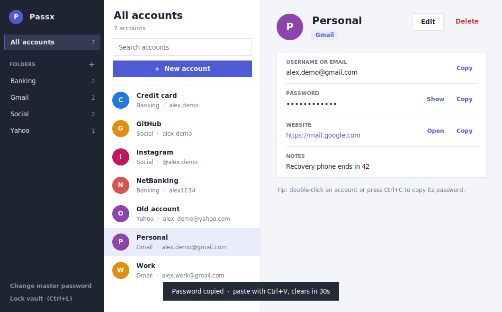
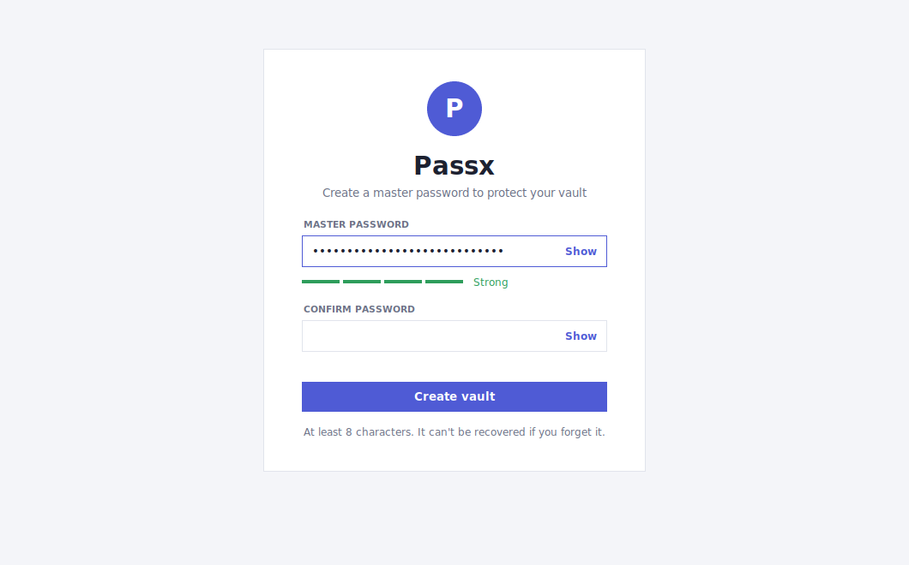
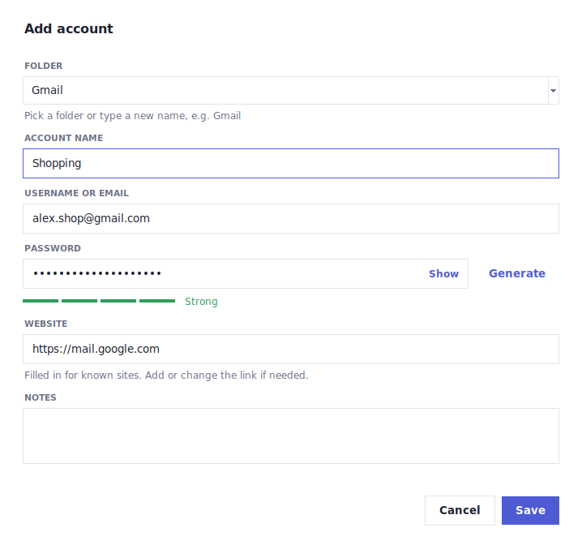

# Passx
A password manager with a desktop GUI protected by a master password, plus a
command line tool that uses GNUPG.



### GUI

```console
$ pip install passx
$ passx-gui
```

On Debian/Ubuntu you may first need `sudo apt install python3-tk`.

- Create a master password on first run; the vault locks after 5 minutes idle (or Ctrl+L).
- Organise accounts in folders such as Gmail, Yahoo or Banking.
- Each account has a name, username/email, password (with a generator), website and notes.
  The website is filled in automatically for well-known sites, and you can type any other link.
- Double-click an account (or press Ctrl+C) to copy its password, then paste it with Ctrl+V.
  The clipboard is cleared after 30 seconds. Ctrl+B copies the username.

| Create your vault | Add an account |
|---|---|
|  |  |

The GUI vault is stored in `~/.config/passx/passwords.vault`, encrypted with
AES-256-GCM using a key derived from the master password with Argon2id
(64 MiB, 3 passes). There is no way to recover the vault if you forget the
master password.

### Command line

#### Installation

 -  Create a GNUPG key pair if not created already, following this [GNUPG tutorial](https://www.gnupg.org/gph/en/manual/c14.html)
 -  After that, when key pair is created. Do following:

   ```console
   $ pip install passx
   ```

#### Usage

```
passx [account]          Copy the password for account to the clipboard
passx -a, --add ACCOUNT  Save an account
passx -d, --delete ACCOUNT
                         Delete an account
passx -l, --list         List all saved accounts
passx -t, --clip-time N  Clear the clipboard after N seconds (default 45, 0 disables)
```

Accounts are stored in `~/.config/passx/vault.gpg`, encrypted for the GPG
recipient saved in `~/.config/passx/recipient.txt`. Plaintext is never written
to disk, and the previous vault is kept as `vault.gpg.bak` on every save.
`$GNUPGHOME` is respected.

Upgrading from 0.0.7 or earlier: the old `~/.config/passx/encrypted/pass.gpg`
database is migrated automatically on first run and renamed to
`pass.gpg.migrated`. Delete it once you've confirmed your accounts are intact.

### Development

```console
$ pip install -e . pytest
$ pytest
```
